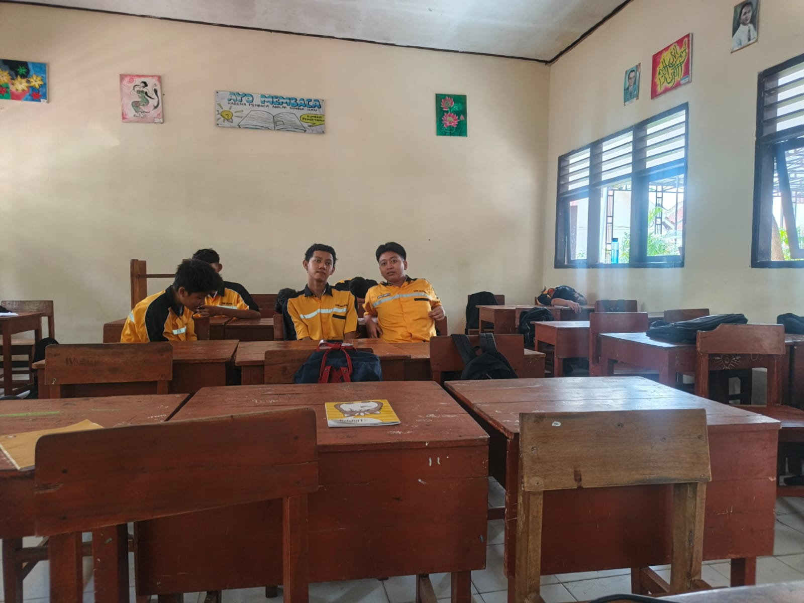

# Siswa Kelas X TMK

Saya adalah seorang siswa kelas X jurusan Teknik Mekatronika (TMK) di SMK Negeri 2 Lamongan yang memiliki ketertarikan besar pada bidang otomasi industri, sistem mekanik, elektronika, dan pemanfaatan teknologi digital.

## Keahlian

• Dasar-Dasar Teknik Mesin & Kelistrikan
• Elektronika Dasar & Sistem Kontrol
• Pembacaan Gambar Teknik & Rangkaian Skematik
• Penggunaan Alat Ukur Mekanik & Listrik (Jangka Sorong & Multimeter)
• Keselamatan dan Kesehatan Kerja (K3) Industri

## Proyek & Praktikum Unggulan

- **Portofolio Web dengan GitHub Pages:** Tugas praktik membuat halaman portofolio online menggunakan GitHub untuk mempelajari penerapan teknologi Cloud Computing.

## Mata Pelajaran

- **Mapel:** Informatika
- **Pengajar:** Pak Agus Halui

